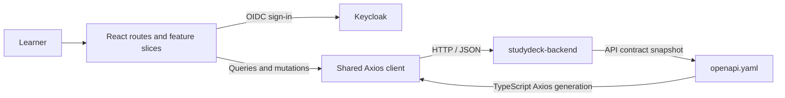

<!-- markdownlint-disable-next-line MD041 -->
<div align="center">

<h1>StudyDeck AI — Web App</h1>

<p><strong>Organize your notes, find the cards due today, and practice what you haven’t learned yet.</strong></p>

<p>
<a href="https://github.com/diegnghtmr/studydeck-frontend/actions/workflows/ci.yml"></a>


<a href="LICENSE"></a>
</p>

<p>
<a href="https://diegnghtmr.me/en/work/studydeck-ai/"><strong>Case study</strong></a> &bull;
<a href="#quick-start"><strong>Quick start</strong></a> &bull;
<a href="#architecture"><strong>Architecture</strong></a> &bull;
<a href="https://github.com/diegnghtmr/studydeck-backend"><strong>Backend API</strong></a>
</p>

</div>

<p align="center"></p>

StudyDeck brings notes, decks, and spaced repetition into one browser app. Open the dashboard to see what is due, reveal each answer before rating your recall, and let the scheduler decide what comes back next. If you generate cards from notes, you can edit or discard the drafts before adding them to a deck.

## Features

- **Daily study dashboard.** See cards due, your daily goal, and a deck to review next.
- **Deck and card library.** Organize study material by topic and narrow a deck’s cards by text or card type.
- **Recall sessions.** Reveal the answer, then rate it from Again to Easy to update the schedule.
- **JSON import.** Validate and preview a card import before committing it to a deck.
- **Editable AI drafts.** Review and select generated cards before importing them; generation alone does not save them.
- **Ask your notes.** Add source documents and use the backend’s retrieval and chat APIs to ask about their contents when a chat model is configured.

## Preview


*Browse a deck and filter its cards without starting a review.*


*Ratings are available after the learner reveals the answer.*

## Quick start

Use Node.js 22 and pnpm 11.0.8, as in CI. The app shell can start without the backend, but decks, reviews, and document features need the [StudyDeck backend](https://github.com/diegnghtmr/studydeck-backend#quick-start).

```sh
git clone https://github.com/diegnghtmr/studydeck-frontend.git
cd studydeck-frontend
pnpm install --frozen-lockfile --ignore-scripts
pnpm dev
```

Open `http://localhost:5173`. The frontend defaults to `http://localhost:8080` for API calls. Set `VITE_API_URL` to override it. Use the [local Keycloak or development JWT setup](docs/reference.md#environment-and-authentication) to exercise authenticated features.

`docker compose up --build` serves the production bundle at `http://localhost:3000`. Use the Vite setup above for custom API and OIDC settings; the running nginx container cannot change the compiled bundle.

## Architecture

Routes and providers live in `src/app`. Feature slices own study, review, decks, documents, and AI screens; shared auth, API, and UI code lives under `src/shared`. TanStack Query handles server state and Zustand stores client state. The dashboard statistics call uses the shared Axios client directly where the checked-in contract does not have the endpoint.



### OpenAPI client generation

The app builds against checked-in TypeScript bindings; Java is only needed to [regenerate the client](docs/reference.md#openapi-client-generation) when the contract changes.

## Tech stack

| Layer | Technology |
| --- | --- |
| Interface | React 19, TypeScript 6, React Router |
| Design | Tailwind CSS 4 `@theme` tokens in [`src/styles/app.css`](src/styles/app.css), with Inter and Fraunces |
| Data and state | TanStack Query, Axios, OpenAPI Generator, Zustand |
| Build and checks | pnpm, Vite, ESLint, Vitest, Playwright Chromium |

## Testing

```sh
pnpm lint
pnpm test
pnpm build
pnpm exec playwright install chromium
pnpm test:e2e
```

[CI](.github/workflows/ci.yml) installs from the lockfile, lints, runs Vitest, builds, and runs Playwright against the Vite server in a separate job. The [browser smoke tests](e2e/smoke.spec.ts) cover the app shell and sign-in route without a running API.

## Project structure

```text
src/
├── app/       # Router and providers
├── features/  # Decks, study, review, AI, documents, import, settings and auth
├── shared/    # Axios, generated bindings, auth and shared UI
├── styles/    # Color, type, spacing, radius and shadow tokens
└── test/      # Vitest setup
```

## Documentation

- [Web app reference](docs/reference.md) — authentication and environment variables, OpenAPI client generation, design tokens, package scripts, Playwright, and Docker.

## Related repositories

| Repository | Role |
| --- | --- |
| [studydeck-backend](https://github.com/diegnghtmr/studydeck-backend) | Owns the OpenAPI contract, review scheduling, document retrieval, and persistence |

## License

Released under the [MIT License](LICENSE).
